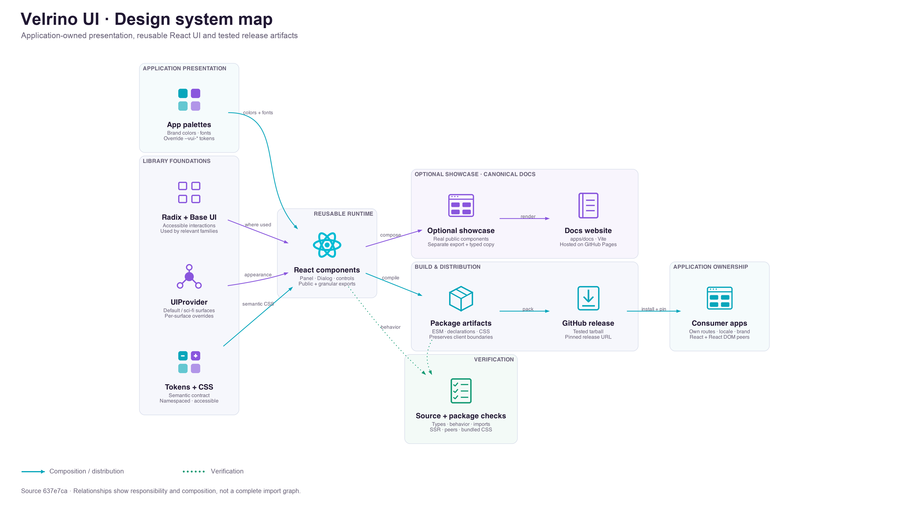

# Architecture

Velrino UI is a framework-independent React package based on the evolved HackUniverse design system. The portfolio is a second consumer with its existing palette.

## Design system map

[](assets/diagrams/design-system-map.svg)

Follow the solid arrows from shared foundations to components, documentation and packaged releases. Dotted arrows show verification. Applications keep their own colors, fonts, routing and state; `UIProvider` selects surface appearance. The documentation site is optional and opens separately from consuming applications.

[Full-size PNG](assets/diagrams/design-system-map.png) · [Self-contained SVG](assets/diagrams/design-system-map.svg) · [Graphviz source](assets/diagrams/design-system-map.dot)

To regenerate the map, install Graphviz (`dot`) and `uv`, then run from the repository root:

```sh
uv run --locked scripts/diagrams/design-system-map.py --output-dir docs/assets/diagrams
```

The renderer declares its Python dependencies inline, pins them in the adjacent lockfile and keeps icons, labels and descriptions in separate rows. Keep the `symbols/` sidecars beside the DOT source; the SVG embeds its icons. This is a map of selected composition and distribution relationships; the boundaries below remain the detailed guide.

## Boundaries

- `components/<family>/` owns implementation, types, CSS, exports and relevant behavior tests. Compose accessible Radix or Base UI primitives rather than rebuilding keyboard or focus handling.
- `hooks/` and `lib/` contain capabilities actually shared by components. Avoid speculative abstractions and application aliases.
- `showcase/` renders the real public components with typed localized copy and explicit brand adapters. Its separate export keeps examples out of runtime imports.
- `styles/tokens.css` defines the semantic `--vui-*` contract. Concrete default colors belong here; component effects derive from these tokens.
- Application adapters own routing, brand assets, language selection, persisted themes, authentication, analytics and 3D behavior.

The canonical documentation host lives in `apps/docs/` and deploys to GitHub Pages after validation. Applications link to it in a new tab instead of bundling a second gallery. The optional gallery export remains available for independently branded hosts.

## Styling

Public components use application-agnostic names. `Panel` groups content; `Dialog` manages modal interaction. Standard surfaces are the default. `UIProvider` and per-surface `appearance` allow an explicit sci-fi opt-in independently of colors, fonts, brand or localization. Application adapters choose their own presentation once, including portal content.

Publish ready-to-use, namespaced CSS. Never require a consumer Tailwind source scan, add a global reset, change body styles or download fonts. Clip decorative layers, never content or focus rings. Respect reduced motion and forced colors.

Import `@velrino/ui/styles.css` once, then define an application adapter after it. Root-level tokens reach portal content; dialogs can accept a custom portal container for explicitly scoped surfaces.

## Distribution

TypeScript emits ESM and declarations with explicit `.js` imports. Client entrypoints preserve `use client`. React and React DOM are peers. esbuild bundles CSS separately. GitHub Releases distribute tested tarballs; applications pin the release URL and commit their lockfiles.

There is no Next.js dependency. Validate the actual packed artifact and both actual consumers before calling a release integrated.
